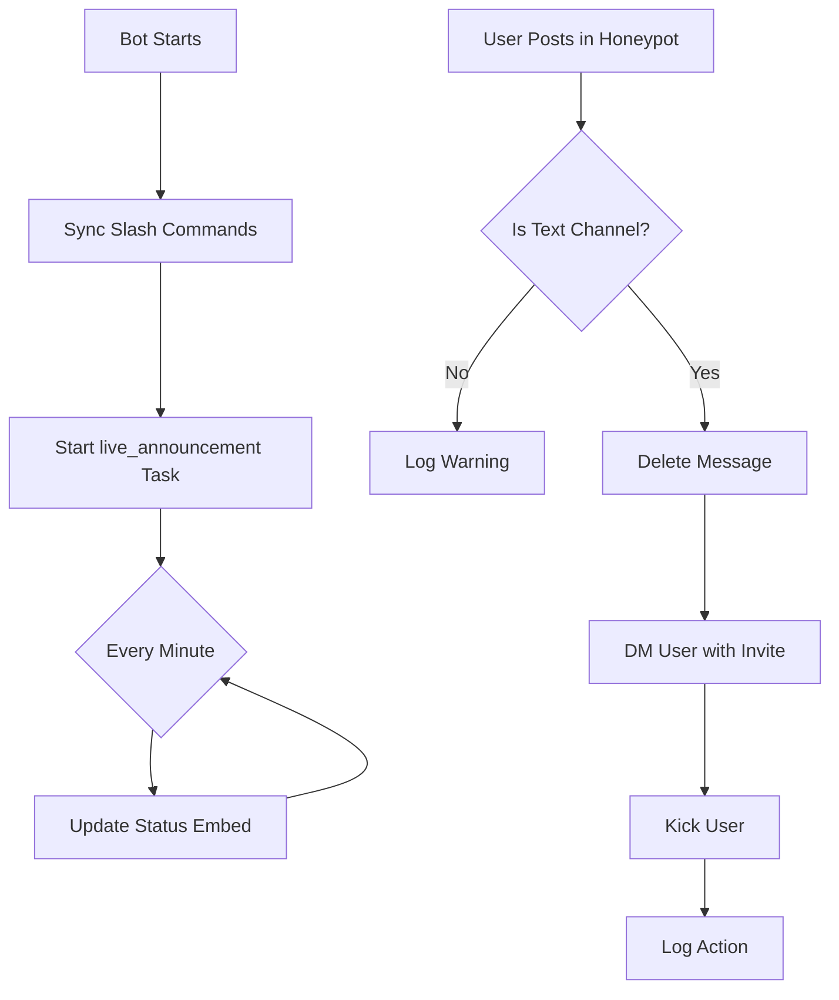

<div align="center">

# 🛡️ LureBan Bot

### *Automated Discord Security & Moderation*

[](https://www.python.org/downloads/)
[](https://github.com/Rapptz/discord.py)
[](https://www.docker.com/)
[](LICENSE)

A sophisticated Discord moderation bot built with Python and `discord.py`. Features automatic honeypot detection, live status monitoring, and slash command utilities.

[Features](#-features) • [Quick Start](#-quick-start) • [Configuration](#-configuration) • [Docker](#-docker-deployment) • [Permissions](#-required-permissions)

</div>

---

## ✨ Features

### 🎯 Security & Moderation
- **🪤 Honeypot Channel Protection** — Automatically kicks members who post in the restricted security channel
- **📨 Smart DM Notifications** — Sends kicked users a rejoin invite with an explanation
- **🔗 Auto-Invite Generation** — Creates temporary one-use invites when no static link is configured

### 📊 Live Status Monitoring
- **⚡ Real-time Status Card** — Auto-updating embed showing bot ping and uptime
- **🕐 IST Timezone Support** — Timestamps in Indian Standard Time
- **♻️ Persistent Message** — Reuses the same embed across restarts (stored in `live_message.json`)

### 🎮 Slash Commands
| Command | Description | Permission |
|---------|-------------|------------|
| `/ping` | Returns bot latency in milliseconds | Everyone |
| `/hello` | Friendly greeting from the bot | Everyone |
| `/echo <message>` | Echoes your message back | Everyone |
| `/clear <amount>` | Bulk-deletes recent messages | Manage Messages |

### 🛠️ Developer Experience
- **🎨 Colored Console Logging** — Beautiful colored output via `colorlog`
- **🐳 Production-Ready** — Docker support with blue/green deployment
- **⚡ One-Command Setup** — `bootstrap.py` handles venv creation, dependencies, and startup
- **📁 Clean Architecture** — Modular structure with typed bot subclass

---

## 📁 Project Structure

```
LureBan_Bot/
├── 🚀 base_app.py                # Bot initialization (Docker entry point)
├── 🏠 main.py                    # Local development entry point
├── ⚙️ bootstrap.py               # Automated setup script
├── 📦 requirements.txt           # Python dependencies
├── 🐳 Dockerfile                 # Container definition
├── 🔧 docker-compose.yml         # Multi-container orchestration
└── 📂 src/
    ├── 🤖 bot.py                 # Typed LureBanBot subclass
    ├── ⚙️ config/
    │   ├── config.py             # Environment variable loader with validation
    │   └── live_message.json     # Persistent live-status message ID
    └── 🛠️ utils/
        ├── commands.py           # Slash commands + live announcement task
        ├── events.py             # Gateway events (on_ready, on_message)
        └── utils.py              # Colored logger utility
```

> **💡 Tip:** `base_app.py` and `main.py` both start the bot. Use `main.py` locally, or run `python bootstrap.py` for zero-config setup.

---

## 🚀 Quick Start

### Prerequisites
- ✅ **Python 3.12+** installed
- ✅ **Discord Bot Token** from the [Developer Portal](https://discord.com/developers/applications)
- ✅ **Privileged Gateway Intents** enabled:
  - `SERVER MEMBERS INTENT`
  - `MESSAGE CONTENT INTENT`

### One-Command Setup (Recommended)

```bash
python bootstrap.py
```

That's it! The script will:
1. 🏗️ Create a virtual environment (`.venv`)
2. 📦 Install all dependencies
3. 🚀 Start the bot

### Manual Setup

<details>
<summary>Click to expand manual installation steps</summary>

#### 1. Clone & Navigate
```bash
git clone <repository-url>
cd LureBan_Bot
```

#### 2. Create Virtual Environment
```bash
python -m venv .venv

# Windows
.venv\Scripts\activate

# macOS / Linux
source .venv/bin/activate
```

#### 3. Install Dependencies
```bash
pip install -r requirements.txt
```

#### 4. Configure Environment (see below)

#### 5. Start the Bot
```bash
python main.py
```

</details>

---

## ⚙️ Configuration

### Environment Variables

Create a `.env` file in the project root:

```env
# Required
DISCORD_TOKEN=your_discord_bot_token_here
kick_user_channel_id=123456789012345678

# Optional
i_am_live_channel_id=123456789012345678
commands_channel_id=123456789012345678
invite_link=https://discord.gg/yourinvite
```

### Configuration Reference

| Variable | Required | Description |
|----------|:--------:|-------------|
| `DISCORD_TOKEN` | ✅ | Your bot token from the [Discord Developer Portal](https://discord.com/developers/applications) |
| `kick_user_channel_id` | ✅ | The honeypot channel — posts here trigger auto-kick + hosts the live status embed |
| `i_am_live_channel_id` | ⬜ | Reserved for future live announcement features |
| `commands_channel_id` | ⬜ | Reserved channel for command-related logic |
| `invite_link` | ⬜ | Static rejoin link for kicked users (auto-generates temp invite if omitted) |

> **⚠️ Important:** `kick_user_channel_id` serves **dual purpose** — it's both the honeypot trigger channel and the location for the live status card.

---

## 🐳 Docker Deployment

### Quick Start with Docker Compose

```bash
docker compose up --build
```

### Blue/Green Deployment

Run a specific deployment slot:

```bash
# Blue slot
docker compose up --build lureban-bot-blue

# Green slot
docker compose up --build lureban-bot-green
```

### Container Details

- **Base Image:** `python:3.12-slim`
- **Entry Point:** `base_app.py`
- **Health Check:** Process monitoring with 10s interval
- **User:** Non-root `botuser` for security
- **Graceful Shutdown:** `SIGTERM` handling for zero-downtime deploys

> **📝 Note:** Ensure your `.env` file exists before running — Docker Compose inherits all variables from it.

---

## 🔐 Required Permissions

Grant these permissions to your bot role in Discord:

| Permission | Purpose | Critical |
|------------|---------|:--------:|
| **Kick Members** | Remove users who post in the restricted channel | ✅ |
| **Manage Messages** | Delete the triggering message before kicking | ✅ |
| **Send Messages** | Post and update the live status embed | ✅ |
| **Embed Links** | Render the live status card | ✅ |
| **Read Message History** | Fetch existing live message for editing | ✅ |
| **Create Instant Invite** | Generate temporary rejoin links (if no static link set) | ⬜ |

### Permission Integer

Use this permission integer when generating your bot invite URL:
```
268446736
```

Or use this invite URL template:
```
https://discord.com/api/oauth2/authorize?client_id=YOUR_BOT_CLIENT_ID&permissions=268446736&scope=bot%20applications.commands
```

---

## 🔄 How It Works



### Detailed Flow

1. **🚀 Startup Sequence**
   - Bot connects to Discord gateway
   - Syncs slash commands globally
   - Starts background task `live_announcement` (fires every 60s)
   - Logs successful connection with bot name and ID

2. **📊 Live Status Updates**
   - Every minute, the task builds a fresh embed with current ping and uptime
   - Checks `src/config/live_message.json` for an existing message ID
   - If found, edits the existing message; otherwise posts a new one
   - Saves the message ID for persistence across restarts

3. **🪤 Honeypot Detection**
   - `on_message` event fires for every message
   - If message is in `kick_user_channel_id`:
     - Narrows channel type to `TextChannel` (required for `create_invite`)
     - Resolves invite link (uses static config or generates temp invite)
     - DMs the user explaining the kick + rejoin link
     - Deletes the message and kicks the member
     - Logs the action to console

4. **🎨 Colored Logging**
   - All output uses `colorlog` for visual clarity:
     - 🔵 `DEBUG` → Cyan
     - 🟢 `INFO` → Green
     - 🟡 `WARNING` → Yellow
     - 🔴 `ERROR` → Red
     - ⚫ `CRITICAL` → Red on white background

---

## 🧪 Development

### Running Tests
```bash
# Install dev dependencies (when added)
pip install -r requirements-dev.txt

# Run tests
pytest
```

### Code Quality
```bash
# Type checking
pyright

# Linting
ruff check .

# Formatting
black .
```

---

## 📝 Dependencies

| Package | Version | Purpose |
|---------|---------|---------|
| `discord.py` | Latest | Discord API wrapper |
| `python-dotenv` | Latest | Environment variable loading |
| `colorlog` | Latest | Colored console output |
| `tzdata` | Latest | Timezone database (for IST) |

---

## 🤝 Contributing

Contributions are welcome! Please:

1. Fork the repository
2. Create a feature branch (`git checkout -b feature/amazing-feature`)
3. Commit your changes (`git commit -m 'Add amazing feature'`)
4. Push to the branch (`git push origin feature/amazing-feature`)
5. Open a Pull Request

---

## 📄 License

This project is licensed under the MIT License — see the [LICENSE](LICENSE) file for details.

---

## 🆘 Troubleshooting

<details>
<summary><strong>Bot doesn't respond to slash commands</strong></summary>

- Ensure privileged intents are enabled in the Developer Portal
- Check that the bot has been invited with `applications.commands` scope
- Verify slash commands synced successfully in the startup logs
</details>

<details>
<summary><strong>Live status card doesn't update</strong></summary>

- Check that `kick_user_channel_id` points to a valid `TextChannel`
- Verify the bot has `Send Messages` and `Embed Links` permissions
- Check console logs for permission errors
</details>

<details>
<summary><strong>Kicked users don't receive DMs</strong></summary>

- Some users have DMs disabled from server members
- The bot logs a warning when DM fails — this is expected behavior
- Ensure your static `invite_link` is valid, or the bot has `Create Instant Invite` permission
</details>

<details>
<summary><strong>Docker container exits immediately</strong></summary>

- Ensure `.env` file exists in the project root
- Check `DISCORD_TOKEN` is set correctly
- Run `docker logs <container-name>` to see startup errors
</details>

---

<div align="center">

### 🌟 Star this repo if you find it useful!

Made with ❤️ using [discord.py](https://github.com/Rapptz/discord.py)

</div>
